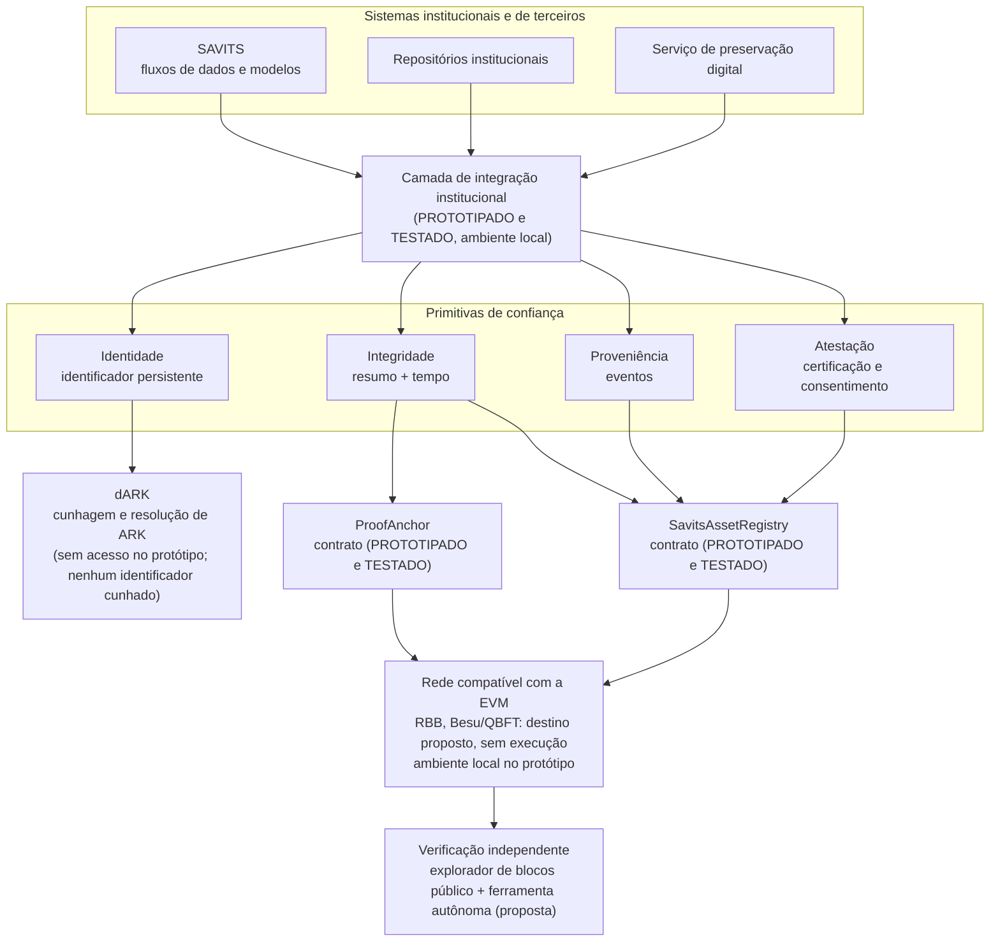
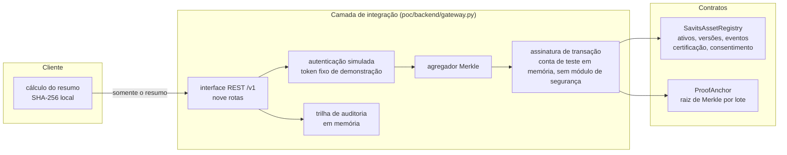
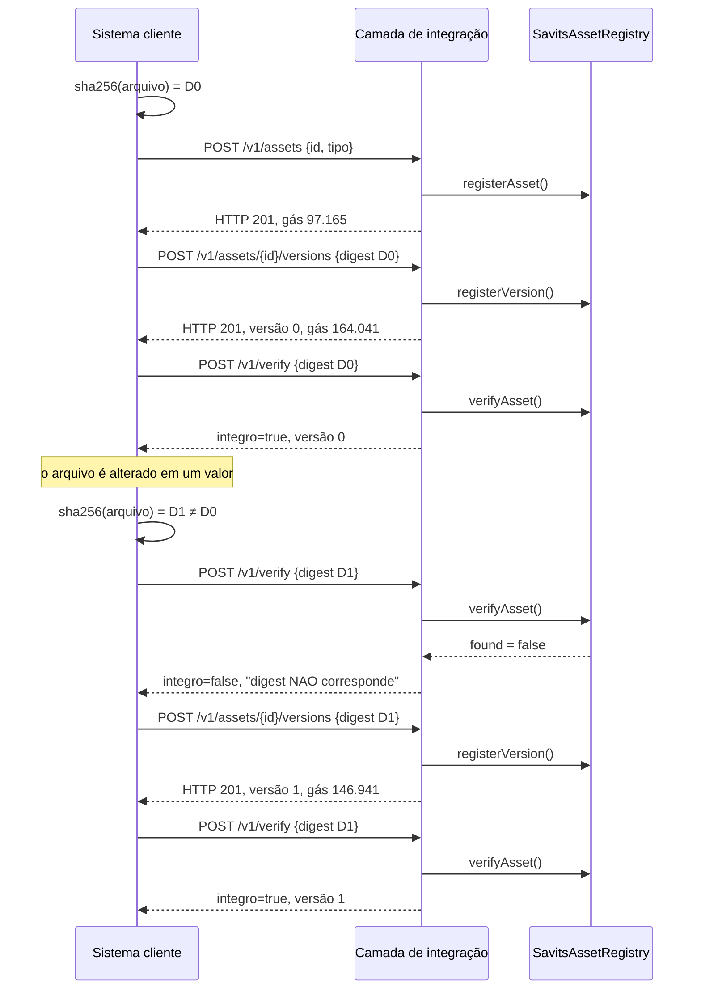
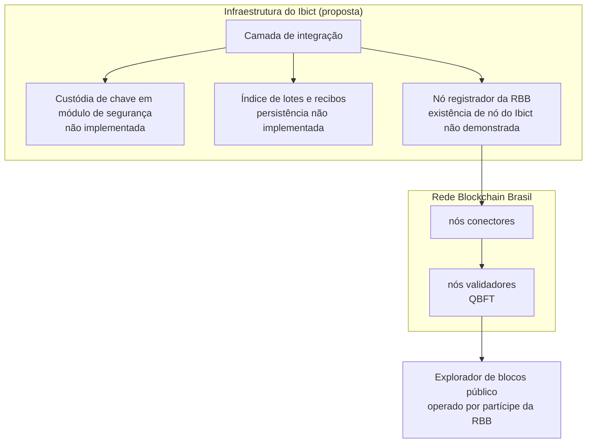

# Documento de arquitetura

Projeto SAVITS, frente Blockchain/RBB. Documento técnico citado no Relatório final de atividades (seção 3.8).

**Classificação de maturidade: MODELADO e PROPOSTO.** Requisitos arquiteturais e decisões arquiteturais: MODELADO (relatório, seção 3.3). Arquitetura de referência: PROPOSTO, parcialmente prototipada (relatório, seção 3.3). Contratos e camada de integração que a exercitam: PROTOTIPADO e TESTADO, exclusivamente em ambiente local (relatório, seções 3.4 e 3.5).

A arquitetura aqui descrita não foi adotada pelo SAVITS nem pelo Ibict, inexistindo decisão institucional a respeito. O que existe é uma proposta tecnicamente justificada (este documento), submetida à apreciação da coordenação, e um protótipo experimental que a exercita em ambiente local compatível com a Máquina Virtual Ethereum (EVM), provido por eth-tester sobre py-evm (`poc/`, `contracts/`, `tests/`). Nenhuma transação foi submetida à rede de produção, à rede piloto ou à rede de testes da Rede Blockchain Brasil (RBB), e nenhum identificador foi cunhado no dARK.

---

## 1. Requisitos arquiteturais

Derivados da descrição oficial da atividade A1 (escalabilidade, privacidade, interoperabilidade, conformidade com a Lei nº 13.709/2018), das características dos artefatos a identificar e das restrições levantadas na investigação da RBB e do dARK. A coluna de verificação remete aos testes da suíte `tests/run_tests.py` (relatório, seção 3.4). Estão sintetizados na seção 3.3 do relatório.

| ID | Requisito | Tipo | Origem | Verificação |
|---|---|---|---|---|
| RF-01 | Registrar ativo científico (conjunto de dados, modelo) com identidade estável | Funcional | A2 | T01 |
| RF-02 | Registrar versões sucessivas com resumo criptográfico do conteúdo | Funcional | A2 | T02, T03, T09 |
| RF-03 | Registrar eventos de proveniência ligando versões de origem a versões derivadas | Funcional | A2 (rastreabilidade) | T04 |
| RF-04 | Verificar se um artefato corresponde a alguma versão registrada | Funcional | A2 (integridade) | T06, T08 |
| RF-05 | Certificar uma versão, com emissor identificado, e revogar a certificação | Funcional | A3 (certificação) | T11a |
| RF-06 | Registrar e revogar consentimento sem expor dado pessoal | Funcional | A3 (consentimento) | T11b |
| RF-07 | Vincular identificador persistente externo (ARK/dARK) ao ativo | Funcional | 2.3.2 | T14, com identificador SIMULADO |
| RNF-01 | Não gravar em cadeia dado pessoal, conteúdo de artefato ou localização | Privacidade e LGPD | A1; art. 18 da Lei nº 13.709/2018 | Revisão de esquema; `analise-de-conformidade-lgpd.md` (relatório, seção 3.3) |
| RNF-02 | Custo por objeto compatível com acervos de 10⁵ a 10⁶ itens | Escalabilidade | A1; volumes institucionais desconhecidos (INFORMACOES-NECESSARIAS.md, item 8) | Experimento E2 até 10⁵ objetos (`analise-de-escalabilidade.md`); compatibilidade não verificada, por depender de volumes e de parâmetros de custo desconhecidos |
| RNF-03 | Verificação possível sem depender de serviço do Ibict | Confiança | Análise de ponto único de falha | T13; `verifyAsset` e `verifyInclusion` são funções públicas de leitura (`view`) |
| RNF-04 | Sistemas clientes não manipulam chaves nem transações | Interoperabilidade | A1; limitação de ergonomia observada no ecossistema dARK | Sessão de demonstração da camada de integração (`evidence/logs/gateway-session.log`) |
| RNF-05 | Toda operação deixa trilha de auditoria imutável | Auditabilidade | A2 (imutabilidade) | Eventos Solidity em todas as funções de escrita, exceto `setSubmitter` (`ProofAnchor`), que não emite evento |
| RNF-06 | Controle de acesso por papel institucional | Segurança | `modelo-de-ameacas.md` | T12 |
| RNF-07 | O artefato permanece fora da cadeia, sob custódia do detentor | Preservação e custo | RNF-01, RNF-02 | Por construção do protocolo: só o resumo trafega |

Observações sobre a verificação:

- RF-05 e RNF-06: o teste T12 exercitou a recusa a conta sem papel no registro de ativo e na revogação de certificação; não a exercitou na emissão de certificação. A verificação de que apenas o emissor revoga a própria certificação (`require(c.certifier == msg.sender)` em `revokeCertification`) está implementada no contrato, mas não foi exercitada pelo teste publicado: o cenário correspondente empregou conta sem papel de certificador e certificado já revogado, e foi barrado antes pela verificação de papel (relatório, seções 3.3 e 3.4).
- RF-07: o teste T14 demonstra que o modelo de dados comporta a vinculação e que a operação `bindPid` funciona; não demonstra integração com o dARK.

---

## 2. Decisão central: o que vai para a cadeia

A investigação levou a uma separação que atravessa todo o projeto:

> **Em cadeia vai a *prova*. Fora da cadeia ficam o *objeto*, a *descrição* e a *localização*.**

A regra, aplicada campo a campo (relatório, seções 3.3 e 3.4), é única: dados pessoais, conteúdos, metadados descritivos e demais informações que possam vir a exigir alteração ou eliminação permanecem fora da cadeia; nela são registrados apenas os elementos estritamente necessários à prova, à referência e à rastreabilidade.

Consequência prática: o registro em cadeia é composto de resumos criptográficos, carimbos de tempo, referências pseudonimizadas e endereços de remetente, além do tipo do ativo e do identificador persistente (ARK), público por definição e único campo textual do modelo (`pid` em `SavitsAssetRegistry`). Essa decisão sustenta RNF-01 (LGPD), RNF-07 (preservação) e contribui para RNF-02 (custo), cuja compatibilidade com os volumes institucionais não foi verificada. É a mesma estratégia híbrida descrita na documentação técnica oficial do dARK, que mantém metadados essenciais e resumos em cadeia e cargas volumosas fora dela (relatório, seção 3.6; `caracterizacao-do-dark.md`).

---

## 3. Diagrama de contexto

**Leitura do diagrama.** A camada de integração não é um invólucro do dARK: é uma fachada sobre quatro primitivas, das quais a identidade é delegada ao dARK e as demais são atendidas por contratos próprios. Essa escolha é discutida na seção 7 (decisão D1). O diagrama corresponde às cinco camadas da arquitetura de referência (relatório, seção 3.3): consumo (sistemas institucionais e de terceiros), fachada (interface de serviço web única, versionada e autenticada por credencial institucional, esta última proposta e não implementada), domínio (as quatro primitivas), adaptação (o dARK como adaptador de identidade e os contratos próprios) e substrato (rede compatível com a EVM). A verificação situa-se externamente a todas, deliberadamente independente delas.

Diferenças entre a proposta e o protótipo: no protótipo, a primitiva de integridade usa `SavitsAssetRegistry` para verificação de versões (`verifyAsset`) e `ProofAnchor` para ancoragem em lote; a camada de integração não expõe certificação nem consentimento, exercitados diretamente sobre o contrato na suíte de testes (T11a e T11b); a primitiva de identidade responde HTTP 501 (seção 7, D1).

---

## 4. Diagrama de componentes

O protótipo (relatório, seção 3.4) expõe nove rotas: registro de ativo, registro de versão, verificação de integridade, registro de evento de proveniência, ancoragem em lote, verificação de inclusão, consulta de ativo e histórico, verificação de estado do serviço e solicitação de identificador persistente (`POST /v1/pids`, que responde HTTP 501). A autenticação é simulada por *token* fixo de demonstração (`Bearer savits-poc-token`); a autenticação por credencial institucional é proposta, não implementada. O agregador Merkle atua apenas na rota de ancoragem em lote. Toda resposta inclui o cabeçalho `X-Gateway-Environment: LOCAL-EVM-NAO-E-RBB`, para que nenhuma saída do protótipo possa ser confundida com registro em rede real.

O arquivo **nunca** atravessa a fronteira do cliente: na sessão de demonstração, nenhum arquivo foi transmitido ao serviço em momento algum, apenas resumos calculados no cliente. Essa propriedade sustenta a estratégia de conformidade da seção 3.3 do relatório (que não constitui parecer jurídico) e dispensa o serviço de armazenar os artefatos.

---

## 5. Diagrama de sequência: ciclo de verificação e detecção de adulteração

Trecho da sessão efetivamente executada em ambiente local e registrada em `evidence/logs/gateway-session.log` (etapas 1, 3 e 7 a 11). Os valores de gás são os da sessão; na suíte de testes, a mesma operação de registro da versão 0 custou 164.029 (teste T02), valor adotado na seção 3.3 do relatório.

A detecção decorre da sensibilidade do resumo criptográfico a qualquer alteração do conteúdo. A impossibilidade de reescrever o registro sem acordo da rede é propriedade esperada da rede de destino e não foi validada experimentalmente, pois a execução ocorreu em ambiente local (relatório, seção 3.4).

---

## 6. Diagrama de implantação (PROPOSTO, não implantado)

**Necessita validação.** O Ibict é Partícipe Aderente Associado da RBB, categoria que prevê a operação de nós de consenso, mas a existência de nó do Ibict em operação não está demonstrada nas fontes abertas consultadas (relatório, seção 3.7). Permanecem a validar: se há nó do Ibict em operação, de que tipo (pela topologia documentada, transações são submetidas por nós registradores; nós observadores apenas leem), apto ou não a submeter transações de aplicação, e sob que cota. A utilização da rede está ainda sujeita aos critérios de aceitação de casos de uso definidos pela governança da RBB. Ver `caracterizacao-da-rbb.md` e INFORMACOES-NECESSARIAS.md, itens 3, 4 e 6.

---

## 7. Decisões arquiteturais

Estão sintetizadas na seção 3.3 do relatório. Classificação: MODELADO; nenhuma foi validada institucionalmente.

### D1. Separar a atribuição de identificador das demais primitivas
**Contexto.** A hipótese discutida pela equipe era criar camada de encapsulamento sobre o dARK, fazendo dele o núcleo do serviço (relatório, seção 3.7).
**Decisão.** Não fazer do dARK o núcleo. Tratar a atribuição de identificador persistente como *uma* primitiva entre quatro, com o dARK no papel de adaptador de identidade.
**Justificativa.** Se toda operação de confiança exigir um identificador persistente, objetos sem vocação para tanto (uma verificação periódica de integridade, um evento de fluxo de processamento, um registro de operação) passam a recebê-lo, com o efeito potencial de aumentar o volume de identificadores sem curadoria ou sem vocação para citabilidade. Trata-se de risco de projeto, e não de dano demonstrado; a extensão desse efeito sobre o dARK não foi avaliada.
**Contrapartida.** Maior número de componentes do que uma camada única de encapsulamento. Exige disciplina de especificação.
**Consequência.** A camada de integração expõe as rotas de ativos (`/v1/assets`), verificação (`/v1/verify`), eventos (`/v1/events`) e provas (`/v1/proofs/...`) separadamente de `/v1/pids`. No protótipo, `/v1/pids` responde HTTP 501 por ausência de credenciais de acesso ao dARK. Na sessão de demonstração, registro, versionamento, proveniência e verificação foram executados com essa rota respondendo 501; a certificação, que não é exposta pela camada de integração, foi exercitada na suíte de testes (T11a), diretamente sobre o contrato, também sem acesso ao dARK. Esses resultados indicam, em ambiente local, que as primitivas exercitadas não dependem do dARK para funcionar.
**Situação.** MODELADO; refletida no protótipo; não validada institucionalmente.

### D2. Resumo calculado no cliente
**Decisão.** A camada de integração nunca recebe o arquivo.
**Justificativa.** Atende simultaneamente à conformidade legal (o serviço não trata o conteúdo), ao custo (sem armazenamento dos artefatos) e à confiança (não é preciso confiar que o serviço calculou o resumo corretamente sobre o arquivo certo).
**Contrapartida.** O sistema atesta que um agente autenticado afirmou um resumo em determinado instante (no protótipo, a autenticação é simulada por *token* fixo). Não atesta que o resumo corresponde ao arquivo que o cliente alega deter. Trata-se de limite intrínseco, análogo ao reconhecido por padrões de proveniência de mídia, registrado em `modelo-de-ameacas.md` como ameaça não mitigável.
**Situação.** MODELADO; refletida no protótipo: na sessão de demonstração, nenhum arquivo foi transmitido ao serviço.

### D3. Ancoragem em lote por árvore de Merkle
**Decisão.** Para operações de volume, publicar apenas a raiz de um lote e emitir recibos com caminho de inclusão.
**Justificativa.** Medição própria em ambiente local (experimento E2, `analise-de-escalabilidade.md`): a ancoragem de um lote custou entre 76.571 e 76.595 de gás para N de 1 a 100.000, praticamente constante (93.683 na primeira ancoragem da suíte, teste T13). O custo do registro individual para N objetos não foi medido com N transações: foi calculado por extrapolação linear a partir de uma chamada medida de `registerVersion` (164.029). Para 1.000 objetos, a razão calculada é de 2.142×.
**Contrapartida.** Os dois mecanismos **não são equivalentes** em função. O registro individual carrega identidade, versão, algoritmo e vínculo com o ativo; o lote prova apenas que um resumo existia em determinado instante. A comparação de gás mede custo, não função. Empregar lote onde se exige versionamento seria erro de projeto.
**Situação.** MODELADO; mecanismo PROTOTIPADO e TESTADO (T13); custo VALIDADO EXPERIMENTALMENTE em ambiente local (E2).

### D4. Consentimento como máquina de estados, nunca como dado
**Decisão.** Em cadeia vão apenas `subjectRef` (referência pseudonimizada ao titular), `termsHash`, `scopeHash` e os instantes de concessão e de revogação.
**Justificativa.** A gravação de dado pessoal em registro de difícil remoção cria incompatibilidade arquitetural com o atendimento a solicitações de eliminação (art. 18, VI da Lei nº 13.709/2018); a extensão dessa incompatibilidade em cada caso concreto depende da interpretação e da aplicação da lei. A revogação é modelada como transição de estado, e não como eliminação.
**Limitação reconhecida.** Pseudonimização não é anonimização. O modelo prevê que `subjectRef` seja derivado com chave mantida fora da cadeia (o comentário do contrato indica HMAC); assim derivado, admitiria reassociação ao titular por quem detenha a chave, e o risco migra para a custódia dessa chave. A derivação com chave não foi implementada: no teste, a referência foi representada por valor ilustrativo. Recomenda-se ainda avaliar se o registro de consentimento deve residir em cadeia, ou se basta ancorar o resumo do termo sem referência ao titular (INFORMACOES-NECESSARIAS.md, item 11). Análise completa em `analise-de-conformidade-lgpd.md`.
**Situação.** MODELADO; máquina de estados TESTADA (T11b), com ressalva jurídica; depende de avaliação do encarregado de dados.

### D5. Plataforma compatível com a EVM
**Decisão.** Solidity sobre EVM.
**Justificativa.** A RBB adota Hyperledger Besu com consenso QBFT, e o dARK adota Besu em sua implementação de referência (relatório, seções 2.3 e 3.7; `caracterizacao-da-rbb.md`, `caracterizacao-do-dark.md`). Ambos são compatíveis com a EVM, o que torna Solidity a escolha coerente, e não uma preferência.
**Contrapartida.** Vincula o trabalho à evolução dessa pilha tecnológica.
**Situação.** MODELADO; contratos compilados com solc 0.8.26, otimizador habilitado em 200 execuções, `evmVersion: paris`, e executados apenas em ambiente local. Compatibilidade de plataforma não equivale a integração com a RBB.
