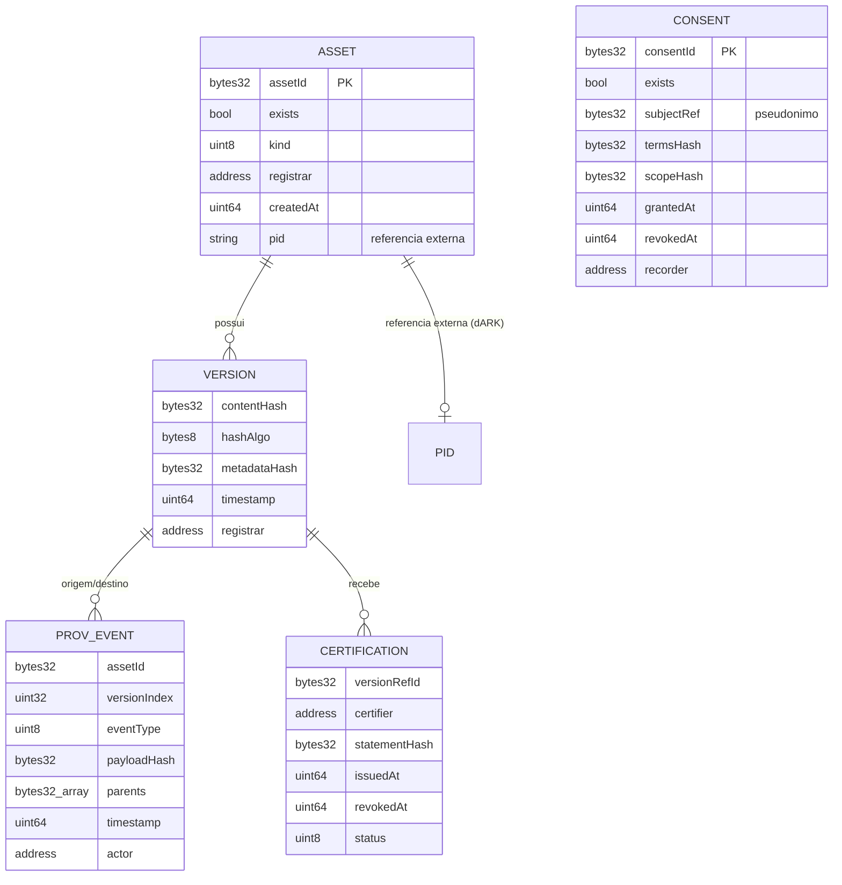

# Modelo de dados: o que fica em cadeia e o que fica fora dela

Projeto SAVITS, frente Blockchain/RBB. Documento técnico citado no Relatório final de atividades (seção 3.8).

**Classificação de maturidade: PROTOTIPADO** (relatório, seção 3.4; matriz-de-maturidade.md). O modelo está implementado em `contracts/contracts/SavitsAssetRegistry.sol` e exercitado em `tests/run_tests.py`, em ambiente local compatível com a Máquina Virtual Ethereum. Não foi executado na RBB nem com dados institucionais.

## 1. Entidades

O modelo compreende cinco entidades: ativo, versão, evento de proveniência, certificação e consentimento. O identificador persistente (ARK, cunhado no dARK) não é entidade do contrato: é referência externa gravada no campo `pid` do ativo.

O consentimento não possui, no contrato, vínculo explícito com ativo ou versão: o escopo autorizado é representado apenas pelo seu resumo (`scopeHash`), e a relação com os ativos que ele autoriza permanece fora da cadeia.

Referência canônica de versão: `versionRef = keccak256(assetId ‖ versionIndex)`, implementada em `versionRef()` como `keccak256(abi.encodePacked(assetId, versionIndex))`. É o que permite que eventos de proveniência (`parents`) e certificações (`versionRefId`) apontem para uma versão específica sem duplicar dados.

Enumerações do contrato:

| Enumeração | Valores |
|---|---|
| `AssetKind` | `DATASET`, `MODEL`, `PIPELINE`, `RESULT`, `DOCUMENT`, `OTHER` |
| `EventType` | `CREATED`, `INGESTED`, `PROCESSED`, `TRAINED`, `EVALUATED`, `DERIVED`, `PUBLISHED`, `DEPRECATED`, `OTHER` |
| `CertStatus` | `NONE`, `ACTIVE`, `REVOKED` |

## 2. Decisão campo a campo

A decisão sobre o destino de cada campo aplica regra única: dados pessoais, conteúdos, metadados descritivos e demais informações que possam vir a exigir alteração ou eliminação permanecem fora da cadeia; nesta são registrados apenas os elementos estritamente necessários à prova, à referência e à rastreabilidade (relatório, seção 3.3). A tabela detalha, com os nomes dos campos do contrato, o que a seção 3.4 do relatório sintetiza.

| Campo | Destino | Justificativa |
|---|---|---|
| `assetId` | **Em cadeia** | Derivado por `keccak256` a partir do identificador de negócio; não revela o identificador de negócio em claro. Fragilidade conhecida, não corrigida: identificador de negócio legível e previsível torna o valor suscetível a ataque de dicionário (ver `analise-de-privacidade.md`) |
| `kind` | **Em cadeia** | Um byte; necessário para consulta e política |
| `pid` (ARK) | **Em cadeia** | Público por definição; é o elo com o dARK. Único campo textual do modelo |
| `contentHash` | **Em cadeia** | É a prova; sem ele o registro não cumpre função |
| `hashAlgo` | **Em cadeia** | Oito bytes; sem identificar o algoritmo a prova é ambígua e não sobrevive a transições criptográficas |
| `metadataHash` | **Em cadeia** | Prova de que o registro descritivo externo não foi alterado, sem expor o registro |
| `timestamp`, `registrar` | **Em cadeia** | Temporalidade e responsabilização; `registrar` é endereço institucional, não pessoa |
| `subjectRef` | **Em cadeia, pseudonimizado** | Derivação com chave mantida fora da cadeia prevista no modelo e **não implementada**; no teste, valor ilustrativo. Ver ressalvas em `analise-de-conformidade-lgpd.md` |
| Conteúdo do artefato | **Fora da cadeia** | Volume, custo, conformidade legal; irrelevante para a prova |
| Metadados descritivos | **Fora da cadeia** | Podem conter dado pessoal (autoria, afiliação) e são mutáveis por natureza |
| Localização do recurso | **Fora da cadeia** | É função do resolvedor (dARK) e muda com o tempo; gravá-la em registro imutável seria erro de projeto |
| Termo de consentimento | **Fora da cadeia** | Documento com dado pessoal; em cadeia vai apenas o `termsHash` |
| Parecer de certificação | **Fora da cadeia** | Documento com dado pessoal; em cadeia vai apenas o `statementHash` |
| Registros de execução de treinamento | **Fora da cadeia** | Volume; em cadeia vai o `payloadHash` do evento |

## 3. Custo medido por operação

Valores medidos na execução de `tests/run_tests.py`, em ambiente local (eth-tester sobre py-evm), compilador Solidity 0.8.26, otimizador habilitado em duzentas execuções, alvo de máquina virtual `paris` (relatório, seção 3.5). O gás expressa custo computacional, não custo financeiro. **Os valores referem-se exclusivamente ao ambiente local e não foram aferidos na Rede Blockchain Brasil.**

| Operação | Função | Gás medido |
|---|---|---|
| Implantação do registro de ativos | construtor de `SavitsAssetRegistry` | 2.163.202 |
| Implantação da ancoragem de provas | construtor de `ProofAnchor` | 522.328 |
| Registrar evento de proveniência (uma origem) | `registerEvent` | 189.112 |
| Registrar versão | `registerVersion` | 164.029 |
| Certificar versão | `certify` | 162.783 |
| Registrar consentimento | `registerConsent` | 161.118 |
| Registrar ativo | `registerAsset` | 97.165 |
| Ancorar lote | `anchorBatch` | 76.571 a 93.683 |
| Vincular identificador persistente | `bindPid` | 74.926 |
| Revogar certificação | `revokeCertification` | 35.768 |
| Revogar consentimento | `revokeConsent` | 33.841 |
| Verificar integridade | `verifyAsset` | Função de leitura, sem custo de transação |
| Verificar inclusão em lote | `verifyInclusion` | Função de leitura, sem custo de transação |

A faixa de `anchorBatch` corresponde aos valores observados no experimento de escalabilidade (76.571 a 76.595, para 1 a 100.000 objetos declarados; arquivo `evidence/test-results/gas-benchmark.csv`) e no teste T13 (93.683, lote de mil folhas). O vínculo de `bindPid` foi exercitado no teste T14 com identificador explicitamente marcado como simulado (`ark:/00000/SIMULADO-ds-politicas`), por ausência de credenciais de acesso ao dARK; nenhum identificador foi cunhado no dARK.

Tamanho do código em execução (relatório, seção 3.5): `SavitsAssetRegistry`, 9.653 bytes; `ProofAnchor`, 1.963 bytes. Ambos abaixo do limite de 24.576 bytes estabelecido pelo EIP-170.

Que as duas funções de verificação sejam de leitura, executadas sem submissão de transação, sustenta o requisito RNF-03: a verificação não exige transação nem autorização do Ibict, enquanto o registro permanecer disponível na rede.

**Observação sobre custo na RBB.** A documentação oficial da RBB aponta, como barreira ao uso de redes públicas por instituições públicas, a aquisição de criptomoedas para remuneração do processamento na rede, e apresenta o modelo público-permissionado como alternativa de menor custo. O que a fonte sustenta é redução de custo e de barreiras de entrada, e não a inexistência de custo financeiro. O gás permanece medida pertinente independentemente do custo financeiro: indica a carga computacional que cada operação impõe a uma infraestrutura compartilhada entre instituições e pode servir de insumo a eventual política de cota definida pela governança da rede. Os parâmetros efetivos de custo e de cota aplicáveis ao Ibict não são conhecidos (INFORMACOES-NECESSARIAS.md, item 4).

Documentos relacionados: `analise-de-conformidade-lgpd.md`, `analise-de-privacidade.md`, `analise-de-escalabilidade.md`, `documento-de-arquitetura.md`, `especificacao-da-interface-de-servico.md`.
